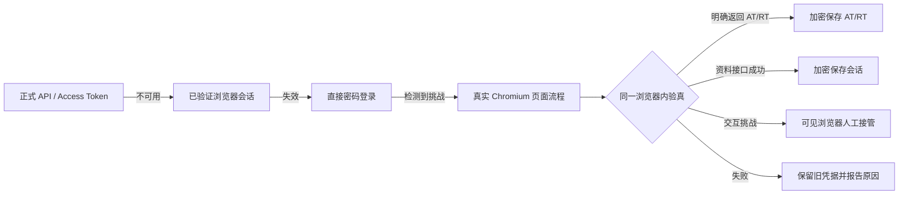

# 霜镜

霜镜是一套可私有部署的上游余额监控面板。它登录你拥有的 New API、Sub2API 或兼容站点账号，读取原始余额，通过四则运算公式转换为人民币，并在低余额时通过 Resend 或飞书告警。你手动充值后，系统连续两次检测到恢复会自动发送恢复通知并结单。

## 核心能力

- New API：默认使用“个人资料 → 安全 → 访问令牌”生成的用户访问令牌，配合 User ID 免登录读取整个账户余额。左侧“API 密钥”属于另一类凭据，只用于读取某一枚调用密钥的剩余额度；系统兼容带或不带 `sk-`。也保留密码登录回退。
- Sub2API：支持 Access Token、Refresh Token 和密码登录；遇 CF 同样先过盾，失败回退 AT/RT。
- 自定义站点：可以配置用户接口路径和余额 JSON 字段。
- 转换器：只允许变量 `x`、数字、括号和 `+ - * /`。
- 告警闭环：低余额建单、通知去重、手动充值、连续恢复确认、自动结单。
- 通知：Resend 邮件、飞书群机器人 Webhook。
- 安全：首次自定义管理员用户名、bcrypt 强密码、Cloudflare Turnstile、TOTP 两步验证、一次性恢复码；上游凭据继续使用 AES-256-GCM 加密。

## 本地运行

```bash
npm install
npm run dev
```

前端开发地址为 `http://localhost:5173`，后端接口为 `http://localhost:8787`。

生产模式：

```bash
npm run build
npm start
```

访问 `http://localhost:8787`。

## Docker 部署

1. 将 `.env.example` 复制为 `.env`。
2. 至少更换 `MASTER_KEY` 和 `SESSION_SECRET`，并保持 `SEED_DEMO=false`。`ADMIN_PASSWORD` 留空时首次打开面板完成管理员初始化。
3. 启动服务：

```bash
docker compose up -d --build
```

运行镜像与项目的 Playwright `1.61.1` 版本严格匹配，内置 Chromium 及系统依赖；入口只以 root 修正旧数据卷权限，随后立即降权到 `pwuser`。Compose 同时加载 Playwright 官方同版本的 seccomp profile，以支持非 root Chromium sandbox。Compose 模式适合无头验证，不提供 VNC；需要人工接管时请在有 GUI/X11/VNC 的受控主机运行并设置 `TURNSTILE_HEADLESS=false`。

数据保存在 Docker 卷 `frosted-data` 中。服务器需允许访问上游域名、`challenges.cloudflare.com`，以及你启用的 Resend/飞书/第三方解题服务。生产环境建议通过 Caddy、Nginx 或 Tailscale 提供 HTTPS 和访问限制。账号凭据锁目前是单进程锁，不要为同一数据卷同时启动多个应用副本。

## 面板登录安全

- 首次打开时自拟管理员用户名，页面默认生成满足复杂度要求的强密码。
- 在 Cloudflare Turnstile 创建站点后，填写 `DASHBOARD_TURNSTILE_SITE_KEY` 和 `DASHBOARD_TURNSTILE_SECRET_KEY`，登录和首次初始化会自动启用人机验证。
- 登录后进入“系统设置 → 账户安全”扫描二维码启用 TOTP，并离线保存一次性恢复码。
- 反向代理部署时设置 `APP_ORIGIN=https://你的域名`；仅在可信代理后方设置 `TRUST_PROXY=true`。

## 转换公式示例

```text
x                         # 原始值已经是人民币
x * 7.2                   # 美元按固定汇率折算
x / 500000 * 7.2          # New API 内部 quota 折算
(x - 5) * 7.2             # 扣除不可用额度后折算
```

系统同时保存原始余额和折算人民币余额。告警阈值、趋势和事件结单均使用折算人民币余额。

## 站点接入建议

- 需要监控整个 New API 用户账户余额时，使用“个人资料 → 安全 → 访问令牌”生成的用户访问令牌，并填写账户 User ID；令牌按页面显示的原始值提交，不加 `Bearer` 或 `sk-`。
- 只监控某一枚调用密钥额度时，使用左侧“API 密钥”创建的有限额度密钥；无限额度密钥无法返回可监控的有限余额。两类凭据用途不同，不应混填。
- Sub2API 推荐保存 Access Token + Refresh Token；密码用于 token 全部失效时的回退登录。
- 不要在多个上游站点复用同一个密码。
- `MASTER_KEY` 丢失后无法解密已有凭据，部署时必须妥善备份。

## Clash 代理出口

Docker Compose 会启动一个仅在内部网络可见的 Mihomo 服务。先在 `.env` 设置强随机 `MIHOMO_SECRET`，再到“系统设置 → 代理池”导入 HTTPS Clash 订阅。订阅地址使用 AES-256-GCM 加密保存，界面和日志不会回显完整地址。

- 节点只按可用性与延迟排序，不把登录、Turnstile、401 或 403 结果计入质量评分。
- 代理在“上游”层启用；同一上游的所有账号共用一个固定节点和独立 HTTP listener。
- 余额 API、站点探测和 Chromium 验证复用同一出口；采集或登录进行中禁止重新分配节点。
- 订阅更新先在临时配置中完成加载与健康检查，失败会恢复旧订阅、节点分配和运行配置。
- 更新订阅不会主动切换仍然可用的固定节点；可在上游编辑弹窗手动“重新分配”。
- Mihomo 控制端口和代理端口不映射到宿主公网；Compose 会等待其健康检查通过，应用也会自动退避重试同步。

本地非 Docker 运行时，需要自行启动 Mihomo，并配置 `MIHOMO_CONTROLLER_URL`、`MIHOMO_SECRET`、`MIHOMO_SHARED_DIR`、`MIHOMO_RUNTIME_PATH` 和 `UPSTREAM_PROXY_HOST`。动态代理 listener 与控制器默认只绑定 `127.0.0.1`；不要在没有防火墙和访问控制时改为公网地址。

## 上游 Cloudflare / Turnstile 处理

Cloudflare Turnstile token 只有 5 分钟有效期、只能验证一次，并且必须由目标站点服务端校验。霜镜因此采用分层认证状态机，不缓存或重放挑战 token：



检测同时覆盖 Cloudflare 官方的 `cf-mitigated: challenge` 响应头、上游 JSON 错误以及 HTML 挑战页。普通 403/429 不会仅凭状态码被误判为 Turnstile。

### New API 的两层防护位置

- **New API 原生 Turnstile**：公开 `/api/status` 通过 `turnstile_check` 与 `turnstile_site_key` 暴露当前开关；官方中间件保护 `/api/user/login`、注册、邮箱验证、重置密码和签到等接口。登录 token 必须按官方协议放在 `?turnstile=...` 查询参数中，霜镜同时保留常见二改站点的请求体字段兼容。
- **站点外层 Cloudflare WAF / Managed Challenge**：不属于 New API 固定路由，可按 IP、频率和规则动态出现在状态、登录、个人资料或令牌接口。霜镜因此在所有上游 JSON 请求上统一检测挑战响应，而不是只检查登录接口。

正式监控仍优先使用 New API 的个人访问令牌与 User ID；原生 Turnstile 或外层 WAF 被触发时再进入浏览器状态机。

### 默认：真实 Chromium 页面流程

```bash
TURNSTILE_SOLVER=browser
TURNSTILE_HEADLESS=true   # 调试时可改为 false 观察页面
TURNSTILE_DISABLE_BROWSER_SANDBOX=false
```

Docker 镜像已内置 Chromium。裸机首次使用时安装浏览器与系统依赖：

```bash
npm install
npx playwright install --with-deps chromium
```

浏览器模式会：

- 打开上游登录页，识别 `.cf-turnstile`、Cloudflare iframe、隐藏 token 输入框等 DOM
- 填入账号密码并完成页面原有的验证与登录流程
- 只接受明确的 `access_token` / `refresh_token`；不会把 2FA 或会话用的通用 `data.token` 当成 AT
- 登录请求一旦提交便把挑战 token 标记为已消费，禁止后端再次重放
- New API 会在同一个浏览器上下文调用资料接口验真，再加密保存会话 Cookie 与对应 User-Agent
- Sub2API 在拿到新 AT/RT 后立即建立凭据检查点，即使随后余额接口故障也不会丢失轮换后的 RT
- 浏览器任务进入有界 worker 队列，面板状态包含 worker、active、queued、成功/失败和平均耗时；队列满时快速失败而不是拖垮服务器
- Docker 启动时会以 `pwuser` 实际启动并关闭一次 Chromium，提前暴露浏览器或 sandbox 配置错误

服务器上的交互式挑战可能无法在无头模式完成。此时错误会明确标记为“需要人工交互”；将 `TURNSTILE_HEADLESS=false` 后，可在有桌面环境的受控机器上完成一次验证，后续轮询优先复用已验证会话。Chromium sandbox 默认开启；只有在隔离、低权限容器确实无法启用时才设置 `TURNSTILE_DISABLE_BROWSER_SANDBOX=true`。

### 长期稳定路径

1. **New API 正式令牌**：优先使用“个人资料 → 安全 → 访问令牌”与 User ID。这类令牌不同于左侧“API 密钥”。密码登录通常只建立会话；除非上游明确返回 `access_token`，霜镜不会声称自动生成了个人访问令牌。
2. **Sub2API AT/RT**：保存 Access Token + Refresh Token，系统会按 JWT 或上游返回的过期时间提前续期并保存轮换结果。
3. **浏览器会话复用**：适合登录受 Turnstile 保护、资料接口本身允许会话访问的 New API 二改站点。
4. **人工接管**：交互挑战、设备确认或站点额外 2FA 出现时，使用可见浏览器完成一次授权，而不是无限重试。
5. **自管上游 Cloudflare**：为监控服务器使用固定出口 IP，并通过窄范围 WAF Skip 规则只放行指定主机、路径和来源；或在账号“高级设置”填写 Cloudflare Access Service Token。两个 Access 请求头只会发送到当前上游同源地址，不会发送给挑战 iframe。不要全站关闭防护，也不要放行动态公网 IP。

Cloudflare 官方参考：[服务端验证与 token 生命周期](https://developers.cloudflare.com/turnstile/get-started/server-side-validation/)、[识别挑战页响应](https://developers.cloudflare.com/cloudflare-challenges/challenge-types/challenge-pages/detect-response/)、[WAF Skip 规则](https://developers.cloudflare.com/waf/custom-rules/skip/)、[Access Service Token](https://developers.cloudflare.com/cloudflare-one/access-controls/service-credentials/service-tokens/)。

### 备选：第三方打码

```bash
TURNSTILE_SOLVER=capsolver
CAPSOLVER_API_KEY=your-capsolver-key

# 或
# TURNSTILE_SOLVER=2captcha
# TWOCAPTCHA_API_KEY=your-2captcha-key
```

第三方服务会接触目标站点 URL、sitekey 和解题任务元数据，使用前应确认上游条款与数据边界。关闭自动处理：`TURNSTILE_SOLVER=none`，改为正式令牌、人工完成浏览器验证或粘贴一次性 Turnstile Token。

## 验证

```bash
npm test
npm run build
```
